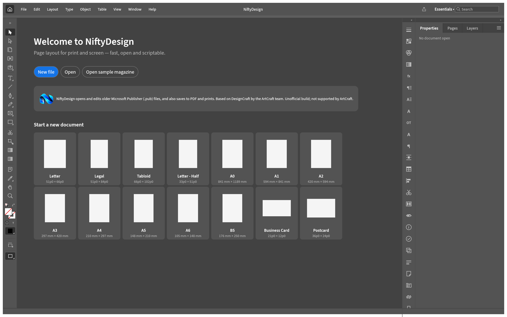
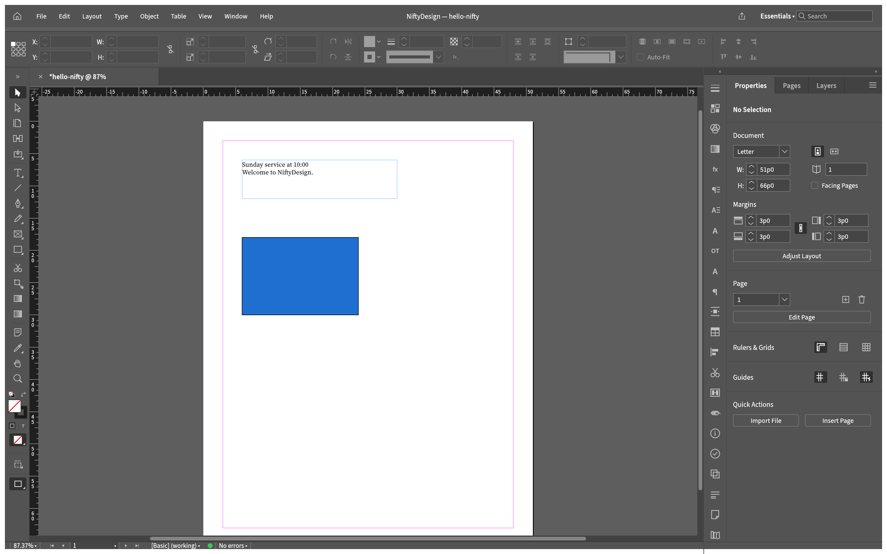
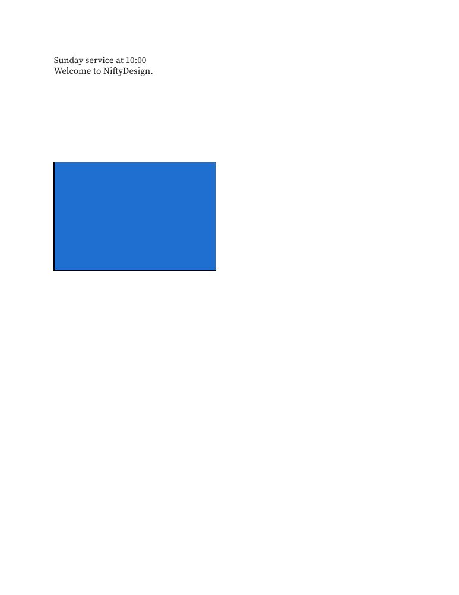
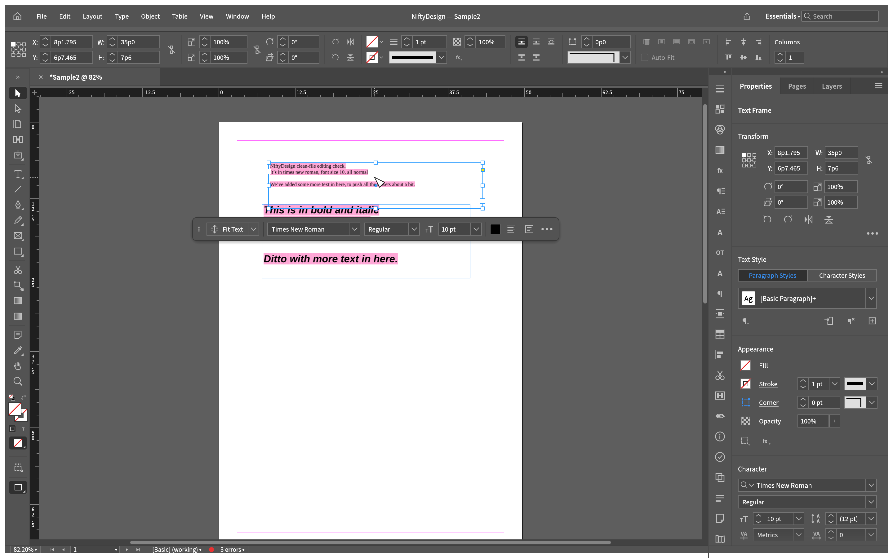
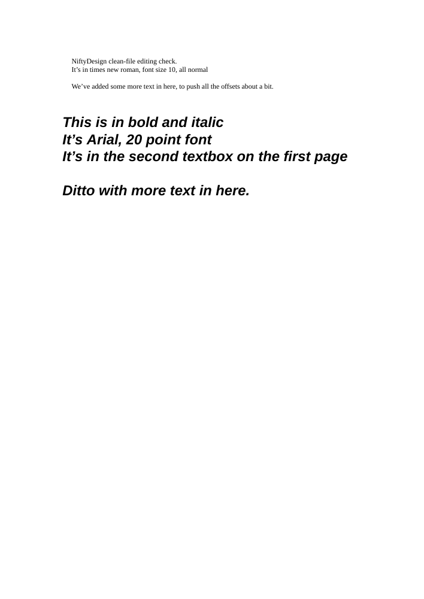

<!-- Copyright (c) 2026 srt8hellcat2-ui. SPDX-License-Identifier: MIT OR Apache-2.0 -->
# NiftyDesign (unofficial alpha)

**Open your old Microsoft Publisher `.pub` files, edit them, save as `.designcraft`, export PDF.**

NiftyDesign is an early, unofficial test build. You do not need Publisher installed. Opening a `.pub` never changes the original. It opens as a new, unsaved document.

> **Based on DesignCraft by the ArtCraft team. Unofficial build; not supported by ArtCraft or Microsoft.**
> Not affiliated with or endorsed by Microsoft or ArtCraft. Microsoft Publisher is a Microsoft trademark.

## Where things are

This is the NiftyDesign source repository. Issues and any future releases belong here. No release is published by this source export.

- Repository: https://github.com/srt8hellcat2-ui/niftydesign
- Report a problem: https://github.com/srt8hellcat2-ui/niftydesign/issues
- Download: https://github.com/srt8hellcat2-ui/niftydesign/releases

## Report problems HERE — never to ArtCraft

Bug reports go to https://github.com/srt8hellcat2-ui/niftydesign/issues. Never report to the ArtCraft repositories or community. ArtCraft did not make or test this build and does not support it. Use the issue forms.

## Important: unsigned alpha, Windows x64 only

- **Windows 64-bit only.** No other platform is offered.
- **The build is not code-signed.** Windows SmartScreen may warn you when you first run it. *UNVERIFIED: the exact wording and clicks have not been recorded.* Run it only if you are comfortable with an unsigned test build, and only if you downloaded it from the Releases page above.

## Check your download (SHA256)

The Windows alpha packaging scripts prepare two checksum items for a release:

- `niftydesign-0.9.0-nifty-alpha.1-windows-x64.zip.sha256` covers the zip itself. Check it before you extract.
- `SHA256SUMS` inside the zip covers the other files in the zip. Check it after you extract.

Put the zip and its `.zip.sha256` file in one folder. In PowerShell, from that folder:

```powershell
$zip = 'niftydesign-0.9.0-nifty-alpha.1-windows-x64.zip'
$expected = ((Get-Content -LiteralPath "$zip.sha256").Trim() -split '  ', 2)[0]
if ((Get-FileHash -Algorithm SHA256 -LiteralPath $zip).Hash -ne $expected) {
  throw "SHA256 mismatch: $zip"
}
```

If it throws, do not run the app. Extract the whole zip to a folder. Then, from inside that folder:

```powershell
Get-Content SHA256SUMS | ForEach-Object {
  $hash, $file = $_ -split '  ', 2
  if ((Get-FileHash -Algorithm SHA256 -LiteralPath $file).Hash -ne $hash) {
    throw "SHA256 mismatch: $file"
  }
}
```

`SHA256SUMS` cannot hash itself. Hashes catch changes. They are not signatures and do not prove who sent the files. Get the files only from the Releases page.

## What works, what partly works, what does not

Results come from the project's own checks (docs dated 2026-10-19 to 2026-10-21). They are not a side-by-side comparison with Publisher. That has not been done.

| | What |
|---|---|
| **Works (automated checks)** | Opening all **142** controlled sample files. These are one-feature files. They are scored against the answer files that came with them, **not against Publisher**. Page size, orientation, page count and master pages. Text frames with fonts, sizes, colours, alignment, indents, line spacing, bullets, tab characters, caps, small caps, superscript, letter spacing. Common shapes and lines, solid and gradient fills, transparency, shadows, groups. Pictures (PNG, JPEG, BMP and similar) with rectangular crops. WordArt kept as editable text. Save as `.designcraft`, reopen, and export PDF. |
| **Partly works** | **Real files** (see below). In the eight Apache test tables, rows and columns import but cell text is not shown yet. The synthetic 2x2 table now draws A1, B1, A2 and B2. Cell fills, borders and uncertain merged-cell text remain unsupported. Freeform curves and some preset shapes become rectangles. PICT pictures show an empty frame. Pattern and texture fills keep only the first colour. Objects with shadows go into the PDF as images. |
| **Not working yet** | Numbered lists. Custom tab stops. Table cell shading and borders. Curved or arched WordArt (comes out straight). Publisher 97, 98 and 2000 files (refused). Page numbers and dates are left out. Objects parked beside the page are left out. Subscript and strikethrough. |
| **UNVERIFIED** | The desktop window and editing in it on a real Windows PC. In-app printing. Whether Windows system fonts are picked up. Any hosted build. The web file picker. |

More detail: [KNOWN-LIMITATIONS.md](docs/KNOWN-LIMITATIONS.md).

## Results on real files

We ran **24 real test files** from the Apache POI test set (pinned by commit):

- **0** opened without warnings.
- **19** opened with warnings.
- **2** were refused as Publisher 97 to 2000.
- **3** were damaged (deliberately, for testing).

A warning lists what could not be brought over fully. Check those spots against the original.

Editing was tried on two of these real files: the newsletter and `Sample2.pub`. Move, resize, replace text, save as `.designcraft`, reopen and export PDF were each run. The engine's own results were checked. A person did not do this in a Windows window.

About the 24 files:

- 15 of the 24 contain only generic content, per our scan.
- The newsletter and the brochure contain Microsoft template content. Their images are not published.
- 24 files is a small sample. Your files may behave differently.

## Printing

File > Print... (Ctrl+P) sends pages through the system print spooler: CUPS on macOS and Linux, and a Windows PDF raster spooler. Printing on a real printer is **UNVERIFIED**. The web build cannot print; export a PDF instead. Export to PDF works (automated checks).

## Fonts

Publisher files use Microsoft fonts. NiftyDesign cannot include them.

- Arial and Times New Roman are replaced by Liberation Sans and Liberation Serif where those fonts are available.
- Arial Black, Franklin Gothic, Rockwell, Elephant, Sylfaen and others are replaced by a default font. Text can wrap differently.
- A Find/Replace Font dialog lists the missing fonts.
- Whether Windows system fonts are picked up on a real Windows PC is **UNVERIFIED**.

Resolved: The earlier same-session picture disappearance was a screenshot-timing bug in the app's `ui.screenshot` command, now fixed. No document or image data was lost.

## Known problems found in testing

- **Table text remains partial.** In the eight Apache test tables, rows and columns import but cell text is not shown yet. The synthetic 2x2 table now draws A1, B1, A2 and B2. Cell fills, borders and uncertain merged-cell text remain unsupported. See [the gallery](docs/gallery/README.md#table-host-linkage-fixed--2026-10-21).
- **Pictures over text.** In the newsletter test, clip art overlaps body text before any edit. The cause was not isolated. Text wrap around pictures and text flow between frames are not shown to work in that test.
- **"N errors" in the status bar.** This is the preflight panel, not a crash and not an import failure. It counts overset text (text that does not fit its frame) plus missing fonts. The newsletter shows 12: six overset items and six missing font families.

## Screenshots

Screenshots are interface renderings from the app's own test renderer on Linux, not a Windows desktop capture.

The demo flyer's background, croissant and coffee-cup pictures are AI-generated; see [ASSETS.md](ASSETS.md) and [assets/demo/NOTES.txt](assets/demo/NOTES.txt).

Each image is an interface rendering from the project's own test renderer, not a Windows desktop capture. Every image uses the project's own synthetic test file or a generic Apache test file.

1. Start screen. Interface rendering from the project's own test renderer, not a Windows desktop capture.

   

2. A synthetic test file in the editor. Interface rendering from the project's own test renderer, not a Windows desktop capture.

   

3. The same file after a text edit. Interface rendering from the project's own test renderer, not a Windows desktop capture.

   

4. Page 1 of the PDF exported from that edit. Interface rendering from the project's own test renderer, not a Windows desktop capture.

   

5. `Sample2.pub` (a generic Apache test file) after a text edit. Interface rendering from the project's own test renderer, not a Windows desktop capture.

   

6. Page 1 of the PDF exported from `Sample2.pub`. Interface rendering from the project's own test renderer, not a Windows desktop capture.

   

## Privacy

Do not post files containing names, addresses, phone numbers or photos of people. See [CONTRIBUTING.md](CONTRIBUTING.md).

## Licence and credit

MIT OR Apache-2.0. The licence and NOTICE files are in the download and in this repository.

Copyright (c) 2026 ArtCraft Team and the DesignCraft contributors. NiftyDesign modifications and the Publisher (.pub) importer: Copyright (c) 2026 srt8hellcat2-ui.

The NiftyDesign name and the Nifty mark (`assets/nifty/`) are owned by srt8hellcat2-ui. They are not covered by the code license. The ArtCraft name and marks belong to ArtCraft. They are not included here.

Based on DesignCraft by the ArtCraft team. Unofficial build; not supported by ArtCraft or Microsoft.
