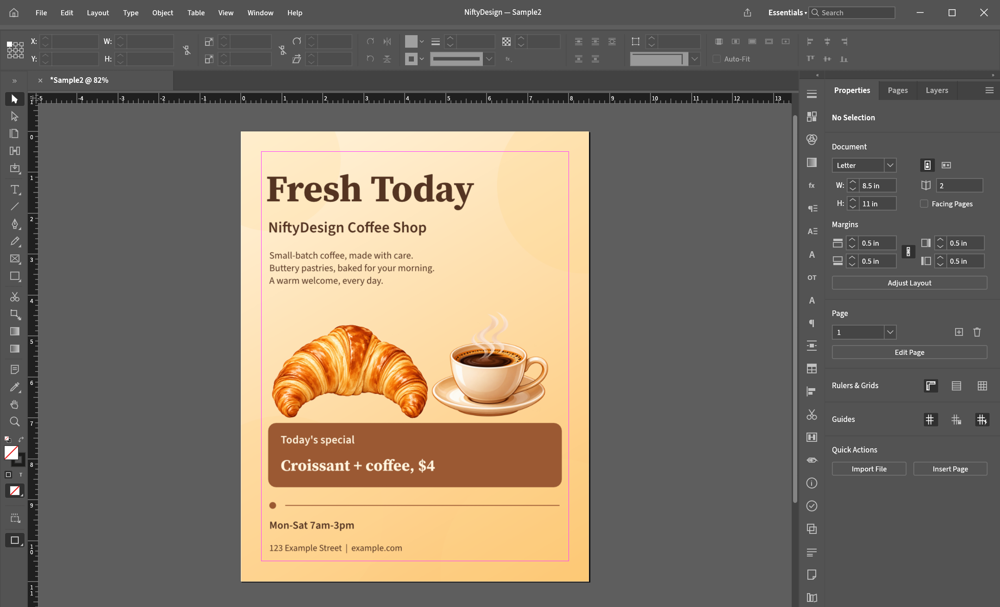
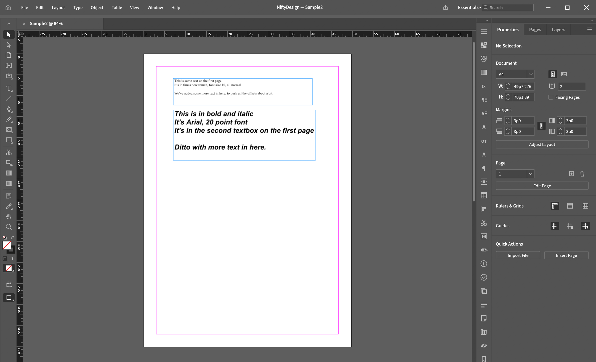
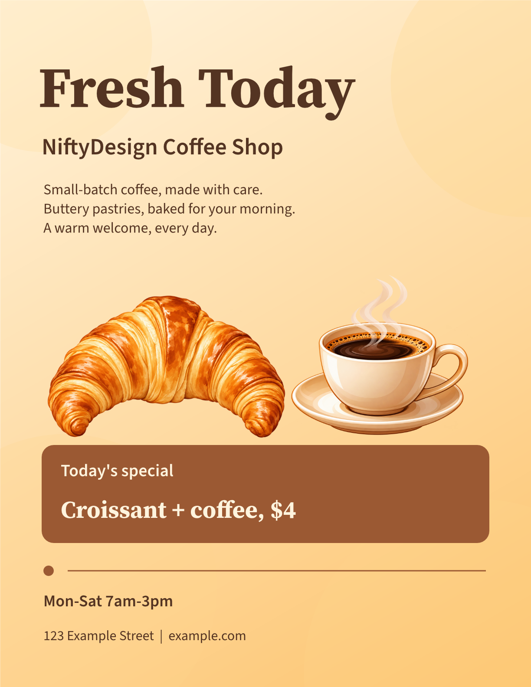
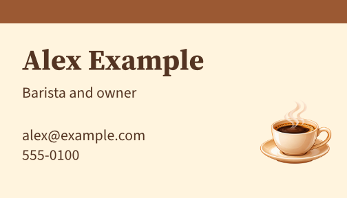

<!-- Copyright (c) 2026 srt8hellcat2-ui. SPDX-License-Identifier: MIT OR Apache-2.0 -->
<h1 align="center"></h1>

<b>Open Your Publisher Files · Edit Them · Export PDF · Save as .designcraft</b>

Open your Microsoft Publisher (.pub) files, edit them, and export PDF. Free, open source, for Windows. <b>Works with files from Publisher 2002 and newer.</b> Publisher 97, 98 and 2000 files are not supported yet. NiftyDesign is an early, unofficial test build. You do not need Publisher installed. <i>Built on DesignCraft by the ArtCraft team.</i>

  
  
  
  
  

  

<a href="#will-my-file-open">Will my file open?</a> · <a href="#install">Install</a> · <a href="#bring-your-file-tell-us-what-broke">Bring your file</a> · <a href="docs/KNOWN-LIMITATIONS.md">Known limitations</a> · <a href="https://github.com/srt8hellcat2-ui/niftydesign/issues/new/choose">Report a problem</a>

A flyer built in NiftyDesign, running on Windows.

> [!NOTE]
> NiftyDesign is independent and unofficial. It is not supported by or affiliated with ArtCraft or Microsoft. Microsoft Publisher is a Microsoft trademark. Report problems here, never to the ArtCraft projects.

## What this is, and what to expect

NiftyDesign is the full DesignCraft desktop app with a Publisher importer added. You can open a `.pub` file, edit it, save it as a `.designcraft` document, and export a PDF. Opening a `.pub` never modifies your original file on disk. NiftyDesign opens a converted copy as a new, unsaved document. That copy can look different from what Publisher shows, because some features are lost or simplified (see the table below). Always compare it with your original.

This is an alpha, and it is honest about that:

- **It has been run by the maintainer on one Windows 11 PC.** There, the app launched, opened a Publisher test file, a flyer and a business card were built in it, saved, reopened after a restart, exported to PDF, and printed on one inkjet printer. Windows system fonts were found. Other PCs and printers are untested, so you may find problems we have not.
- **Our real-file testing is small.** We have tested with public sample files from the Apache POI project and with files we generated for testing. We do not have a collection of real people's Publisher files. That is why we are asking for yours.
- **Real files often open with warnings.** Of 24 real Apache test files, none opened with no warnings, 19 opened with warnings, 2 were refused as too old, and 3 were damaged test files that were correctly rejected. A warning means something was not converted fully. No warning does not prove the copy is perfect, because not every loss produces a warning. Always check the result against your original.

## From a .pub file to a finished page

We opened Apache's public `Sample2.pub` test file in NiftyDesign, then built a flyer and a business card, saved the document, and exported PDF. These are Windows screenshots.

<table>
  <tr>
    <td align="center"> 1. Sample2.pub, opened</td>
    <td align="center"> 2. The flyer page</td>
    <td align="center"> 3. The business card page</td>
  </tr>
</table>

## Will my file open?

These are results from our own checks. We have not compared them side by side with Publisher yet.

| What | Status | Detail |
|---|---|---|
| Publisher 2002 and newer files | Opens, with warnings | Most real files open with warnings. Check against your original. |
| Publisher 97, 98, 2000 files | Not supported | Refused with a message. Re-save in Publisher 2002 or newer first. |
| Text, fonts, colours, bullets | Works | Tested on our sample files. Windows system fonts such as Arial and Times New Roman were found on the test PC. |
| Shapes, lines, fills, shadows | Works | Common shapes. Some freeforms become rectangles. |
| Pictures | Mostly works | PNG, JPEG, BMP. PICT and some clip art may look wrong. |
| Tables | Partly | Real files with tables open, but cell text is not drawn yet. |
| WordArt | Partly | Arched or circular WordArt comes out straight. |
| Numbered lists, custom tab stops | Not yet | Lost on import. |
| Save as `.designcraft` and reopen | Works | Tested after a full restart. |
| Export to PDF | Works | Tested on Windows. |
| Printing | Worked on one printer | Tested on one inkjet printer. Other printers are untested. |

The full list is in [Known limitations](docs/KNOWN-LIMITATIONS.md).

## In progress

We are using every test file we have to find out why files open with warnings, and fixing the biggest causes first. On Windows we ran all 24 of Apache's public test files: 19 open with warnings, 2 are refused as too old, and 3 are damaged test files that are correctly rejected. The biggest known gaps are table cell text (8 of the 24 files), table fills and borders, and warnings that are hard to understand. Numbered lists, tab stops and curved WordArt need sample files. Follow along in [the tracking issue](https://github.com/srt8hellcat2-ui/niftydesign/issues/2).

## Install

1. Download the zip from the [latest release](https://github.com/srt8hellcat2-ui/niftydesign/releases).
2. Right-click the zip and choose **Extract All**.
3. Open the new folder and double-click `designcraft.exe`.
4. Windows may warn you because the alpha is not signed. Choose **More info**, then **Run anyway**. If Windows instead says "An Application Control policy has blocked this file", Smart App Control is blocking unsigned apps and offers no way around it. See [Known limitations](docs/KNOWN-LIMITATIONS.md#windows-smart-app-control-can-block-this-app).

Want to verify the download? (optional)

Each release file shows a SHA-256 value on the Releases page. In PowerShell, run `Get-FileHash .\NiftyDesign-...-windows-x64.zip` and compare it with the `.sha256` file.

Full steps: [docs/TESTER-INSTALL.md](docs/TESTER-INSTALL.md). If the app misbehaves it writes a log. Attach `%APPDATA%\DesignCraft\logs\designcraft.log` to your report if you can.

## Bring your file, tell us what broke

You are among the first to run this. Whatever you find, good or bad, helps.

1. Open an [issue](https://github.com/srt8hellcat2-ui/niftydesign/issues/new/choose) with the bug form or the "file failed to open" form.
2. Tell us your NiftyDesign version, your Windows version, what you did, what happened, and the warning text if there was any.
3. Issues are public. Attach a `.pub` only if everyone may see it, and never post private information. Not sure? Leave the file out and describe the problem.
4. Looking for files? Here is what helps most: [docs/SAMPLE-REQUEST.md](docs/SAMPLE-REQUEST.md). Files from Publisher 2002 to 2010, and files with tables, numbered lists, WordArt or tab stops, are especially useful.

How we handle reports: [docs/TRIAGE.md](docs/TRIAGE.md). Security problems: [SECURITY.md](SECURITY.md).

## Credits and license

Based on **DesignCraft** by the ArtCraft team, licensed MIT OR Apache-2.0. The Publisher importer and NiftyDesign changes are by srt8hellcat2-ui, written clean-room ([how](docs/CLEANROOM.md)). Thanks to everyone who shares sample files, listed with their permission.

See [NOTICE](NOTICE), [LICENSE-MIT](LICENSE-MIT) and [LICENSE-APACHE](LICENSE-APACHE).
