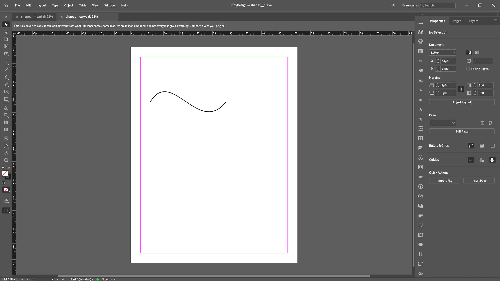
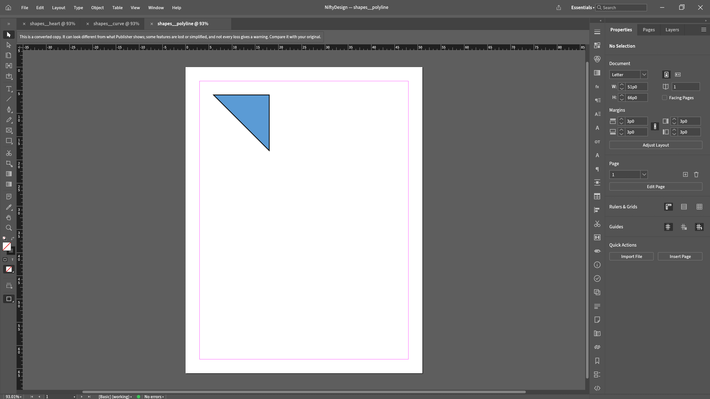
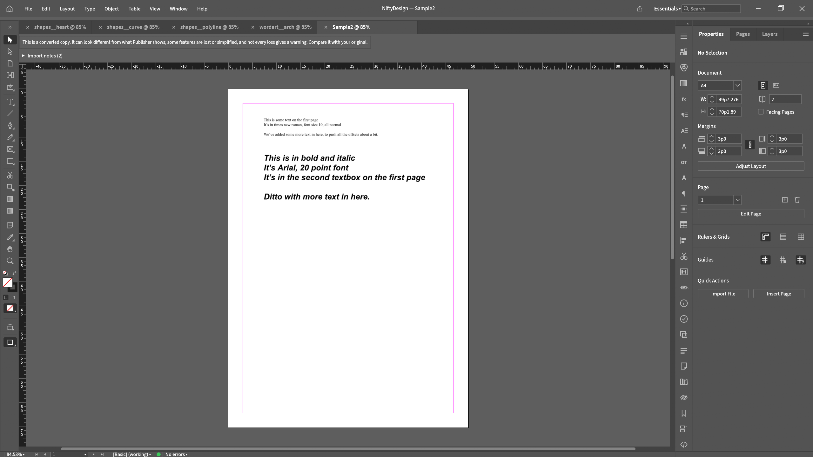
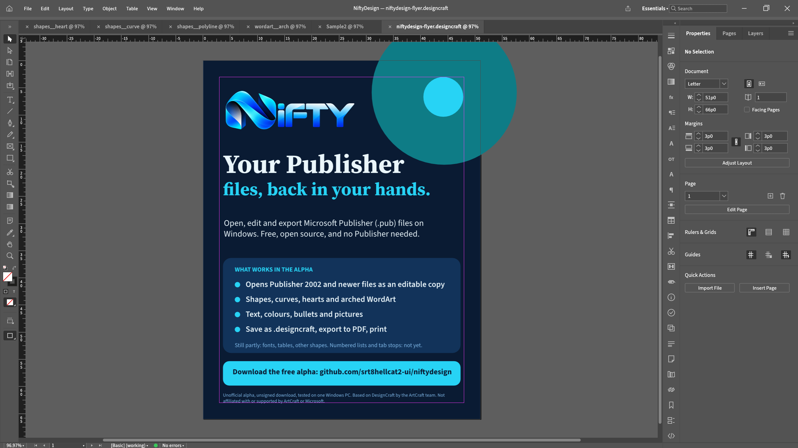

<!-- Copyright (c) 2026 srt8hellcat2-ui. SPDX-License-Identifier: MIT OR Apache-2.0 -->
<h1 align="center"></h1>

<b>Open Your Publisher Files · Edit Them · Export PDF · Save as .designcraft</b>

A free, open-source alternative for opening, editing and converting Microsoft Publisher (.pub) files to PDF on Windows, with no Publisher needed. <b>Works with files from Publisher 2002 and newer.</b> Publisher 97, 98 and 2000 files are not supported yet. NiftyDesign is an early, unofficial test build. You do not need Publisher installed. <i>Built on DesignCraft by the ArtCraft team.</i>

  
  
  
  
  

  

<a href="#will-my-file-open">Will my file open?</a> · <a href="#install">Install</a> · <a href="#bring-your-file-tell-us-what-broke">Bring your file</a> · <a href="docs/KNOWN-LIMITATIONS.md">Known limitations</a> · <a href="https://github.com/srt8hellcat2-ui/niftydesign/issues/new/choose">Report a problem</a>

A flyer built in NiftyDesign, running on Windows.

> [!NOTE]
> NiftyDesign is independent and unofficial. It is not supported by or affiliated with ArtCraft or Microsoft. Microsoft Publisher is a Microsoft trademark. Report problems here, never to the ArtCraft projects.

## What this is, and what to expect

NiftyDesign is the full DesignCraft desktop app with a Publisher importer added. You can open a `.pub` file, edit it, save it as a `.designcraft` document, and export a PDF. Opening a `.pub` never modifies your original file on disk. NiftyDesign opens a converted copy as a new, unsaved document. That copy can look different from what Publisher shows, because some features are lost or simplified (see the table below). Always compare it with your original.

NiftyDesign now shows a notice on every converted .pub: 'This is a converted copy. It can look different from what Publisher shows; some features are lost or simplified, and not every loss gives a warning. Compare it with your original.' The import notes list stays available in the app and in the command-line report.

This is an alpha, and it is honest about that:

- **It has been run by the maintainer on one Windows 11 PC.** There, the app launched, opened a Publisher test file, a flyer and a business card were built in it, saved, reopened after a restart, exported to PDF, and printed on one inkjet printer. Windows system fonts were found. Other PCs and printers are untested, so you may find problems we have not.
- **Our real-file testing is small.** We have tested with public sample files from the Apache POI project and with files we generated for testing. We do not have a collection of real people's Publisher files. That is why we are asking for yours.
- **Real files often open with warnings.** Of 24 real Apache test files: 9 opened with only notes about formatting settings we do not understand and skip, 10 opened with warnings, 2 were refused as Publisher 97, 98 or 2000 files, and 3 were deliberately damaged test files that were correctly rejected. The 9 are not a claim that they match Publisher; we have not compared them with Publisher. Earlier counts called these 9 'warnings'; only the labelling changed, not the importer's fidelity. A warning means something was not converted fully. No warning does not prove the copy is perfect, because not every loss produces a warning. Always check the result against your original.

## From a .pub file to a finished page

We opened Apache's public `Sample2.pub` test file in NiftyDesign, then built a flyer and a business card, saved the document, and exported PDF. These are Windows screenshots.

<table>
  <tr>
    <td align="center"> 1. Sample2.pub, opened</td>
    <td align="center"> 2. The flyer page</td>
    <td align="center"> 3. The business card page</td>
  </tr>
</table>

## Will my file open?

These are results from our own checks. Only nine test files have been compared side by side with Publisher reference images.

| What | Status | Detail |
|---|---|---|
| Publisher 2002 and newer files | Opens, with warnings | Most real files open with warnings. Check against your original. |
| Publisher 97, 98, 2000 files | Not supported | Refused with a message. Re-save in Publisher 2002 or newer first. |
| Text, colours, bullets | Works | Tested on our sample files. |
| Fonts | Partly | Installed fonts are used (Arial and Times New Roman were found on the test PC). Microsoft fonts that are not installed are replaced by a similar available font, so spacing and line breaks can change. |
| Shapes, lines, fills, shadows | Partly | Common shapes, lines, fills and shadows work. Curves and polylines are editable paths and the heart draws as a heart. Other shape types can still come in as rectangles, with a warning. |
| Pictures | Mostly works | PNG, JPEG, BMP. PICT and some clip art may look wrong. |
| Tables | Partly | In the eight Apache test tables, cell text is now drawn (checked by eye on one file and by text search in the PDF output on all eight). Cell fills, borders and padding are still not decoded, text in merged cells is unconfirmed, and row positions can differ by about 0.01 inch for a reason we have not found. Check tables against your original. |
| WordArt | Partly | Default upward arch uses editable paths fitted from measured font advances. Circle and other warps stay straight. |
| Numbered lists, custom tab stops | Not yet | Lost on import. |
| Save as `.designcraft` and reopen | Works | Tested after a full restart. |
| Export to PDF | Works | Tested on Windows. |
| Printing | Worked on one printer | Tested on one inkjet printer. Other printers are untested. |

Microsoft fonts may be substituted with available fonts when they are not installed. Original font names are kept, but spacing and line breaks can change.

The full list is in [Known limitations](docs/KNOWN-LIMITATIONS.md).

## See it in alpha.4

These are screenshots of the NiftyDesign window itself, opening Publisher test files with the alpha.4 build.

<table>
<tr>
<td> A heart shape from a Publisher file (new in alpha.4)</td>
<td> A curve, now an editable path (new in alpha.4)</td>
</tr>
<tr>
<td> A polyline, now an editable path (new in alpha.4)</td>
<td> Arched WordArt as editable curved text (new in alpha.4)</td>
</tr>
<tr>
<td> A real Publisher file (Apache's public Sample2.pub test file)</td>
<td> A flyer built in NiftyDesign with text and shapes only</td>
</tr>
</table>

The flyer is also available as a [PDF](docs/demo/alpha4/alpha4-flyer.pdf), a [PNG](docs/demo/alpha4/alpha4-flyer.png) and an [editable `.designcraft` file](docs/demo/alpha4/alpha4-flyer.designcraft). The saved copy of the Sample2 file is [here](docs/demo/alpha4/alpha4-sample2-copy.designcraft); the original `.pub` is never changed. The earlier coffee-shop flyer and business card are still in `docs/demo/coffee-shop`.

## Where NiftyDesign stands (alpha.4)

**Done**

- ✅ Opens Publisher 2002+ files as an editable copy; originals untouched
- ✅ Text, colours and bullets
- ✅ Pictures (PNG, JPEG, BMP)
- ✅ Lines, fills, shadows and common shapes
- ✅ Curves and polylines as editable paths (new in alpha.4)
- ✅ The heart shape (new in alpha.4)
- ✅ Upward-arch WordArt as editable curved text (new in alpha.4)
- ✅ Missing fonts replaced by the closest available font (new in alpha.4)
- ✅ No font pop-up window when you open a file (new in alpha.4)
- ✅ Table text
- ✅ Save as `.designcraft` and reopen
- ✅ Export to PDF, and printing (tested on one printer)

**Partly**

- 🟡 Fonts: missing Microsoft fonts are substituted; line breaks can change
- 🟡 Tables: fills, borders, padding and merged cells not decoded yet
- 🟡 Other shape types can still come in as rectangles, with a warning
- 🟡 WordArt: circle and other warps stay straight text
- 🟡 Real files: most open with warnings; check them against the original

**Not yet**

- ⬜ Page numbers and dates
- ⬜ A signed download (Windows shows a warning for now)
- ⬜ Testing on more than one Windows PC and printer

**Still needs research** (we do not yet know how Publisher stores or does these)

- 🔬 How Publisher fits text to a frame (some headlines get cut off)
- 🔬 Table cell fills, borders, padding and the small row-position drift
- 🔬 How Publisher bends letters in circle, wave and other WordArt
- 🔬 Numbered lists and custom tab stops (we need sample files)
- 🔬 Publisher 97, 98 and 2000 files (refused today)

Real-file check: of 24 real Apache test files, 9 opened with only notes about formatting settings we skip, 10 opened with warnings, 2 were refused as Publisher 97, 98 or 2000 files, and 3 were deliberately damaged test files that were correctly rejected. We have compared only nine test files with Publisher's own images, so none of this is a claim that files match Publisher. Follow along in [the tracking issue](https://github.com/srt8hellcat2-ui/niftydesign/issues/2).

## Install

1. Download the zip from the [latest release](https://github.com/srt8hellcat2-ui/niftydesign/releases).
2. Right-click the zip and choose **Extract All**.
3. Open the new folder and double-click `designcraft.exe`.
4. Windows may warn you because the alpha is not signed. Choose **More info**, then **Run anyway**. If Windows instead says "An Application Control policy has blocked this file", Smart App Control has blocked it and offers no Run anyway option. Trying again later sometimes helps. See [Known limitations](docs/KNOWN-LIMITATIONS.md#windows-smart-app-control-can-block-this-app).

Want to verify the download? (optional)

Each release file shows a SHA-256 value on the Releases page. In PowerShell, run `Get-FileHash .\NiftyDesign-...-windows-x64.zip` and compare it with the `.sha256` file.

Full steps: [docs/TESTER-INSTALL.md](docs/TESTER-INSTALL.md). If the app misbehaves it writes a log. Attach `%APPDATA%\DesignCraft\logs\designcraft.log` to your report if you can.

## Bring your file, tell us what broke

You are among the first to run this. Whatever you find, good or bad, helps.

1. Open an [issue](https://github.com/srt8hellcat2-ui/niftydesign/issues/new/choose) with the bug form or the "file failed to open" form.
2. Tell us your NiftyDesign version, your Windows version, what you did, what happened, and the warning text if there was any.
3. Issues are public. Attach a `.pub` only if everyone may see it, and never post private information. Not sure? Leave the file out and describe the problem.
4. Looking for files? Here is what helps most: [docs/SAMPLE-REQUEST.md](docs/SAMPLE-REQUEST.md). Files from Publisher 2002 to 2010, and files with tables, numbered lists, WordArt or tab stops, are especially useful.

How we handle reports: [docs/TRIAGE.md](docs/TRIAGE.md). Security problems: [SECURITY.md](SECURITY.md).

## Common questions

**How do I open a .pub file without Microsoft Publisher?**
Download NiftyDesign for Windows from the [latest release](https://github.com/srt8hellcat2-ui/niftydesign/releases), start it, choose **Open** and pick your .pub file. It works with files from Publisher 2002 and newer. It opens a converted copy as a new, unsaved document and never changes your original file.

**Can I convert a .pub file to PDF for free?**
Yes. Open the file, then export PDF. Check the PDF against your original: some features, such as table fills and borders and numbered lists, are not converted yet. WordArt letter fitting remains approximate. See [Known limitations](docs/KNOWN-LIMITATIONS.md).

**Is there a free alternative to Microsoft Publisher?**
NiftyDesign is an early, unofficial alpha built to open and edit existing .pub files. It is not a full Publisher replacement. Other free tools that can import Publisher files include LibreOffice Draw and Scribus.

**Does it open old Publisher 97, 98 or 2000 files?**
Not yet. Those files are refused with a message. Re-save them in Publisher 2002 or newer first.

**Microsoft is retiring Publisher. What happens to my files?**
Microsoft set October 1, 2026 as the date Publisher is retired and loses support. Your .pub files stay on your computer, but the program that edits them is going away. NiftyDesign is one way to keep opening them. Keep your original files either way.

**Why does Windows warn me or block it?**
The alpha is not code-signed yet, so Windows SmartScreen or Smart App Control may warn about it or block it the first time. The [install steps](#install) explain what to do, and [Known limitations](docs/KNOWN-LIMITATIONS.md) says what we saw on our own test PC.

## Credits and license

Based on **DesignCraft** by the ArtCraft team, licensed MIT OR Apache-2.0. The Publisher importer and NiftyDesign changes are by srt8hellcat2-ui, written clean-room ([how](docs/CLEANROOM.md)). Thanks to everyone who shares sample files, listed with their permission.

See [NOTICE](NOTICE), [LICENSE-MIT](LICENSE-MIT) and [LICENSE-APACHE](LICENSE-APACHE).
