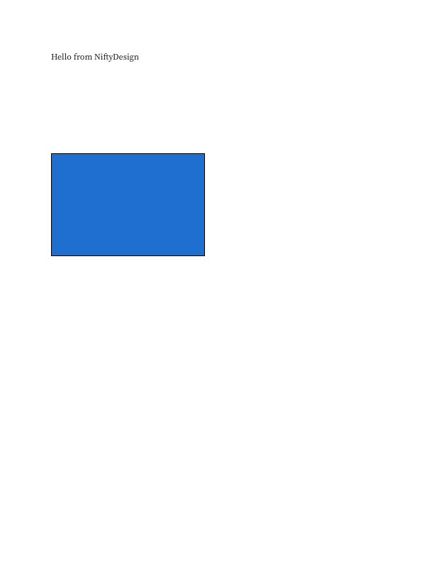

<!-- Copyright (c) 2026 srt8hellcat2-ui. SPDX-License-Identifier: MIT OR Apache-2.0 -->
# NiftyDesign headless sample gallery

Generated on Linux with NiftyDesign CLI `0.9.0-nifty-alpha.1`. These are our
headless renderer's page-1 outputs, not desktop screenshots or Publisher truth
images. No donated or Apache real-file sample was used. The controlled inputs
are `.pub` data only from FuncularLabs/pubsmith at commit `0ccdf27`; hashes and
provenance are recorded in [SOURCES.md](../pub-format/SOURCES.md).

All PNGs are 612 x 792 pixels. CLI page indices start at zero. A successful render
is not a claim of complete visual fidelity to Publisher.

| Image | Source file | What it shows / limitation |
|---|---|---|
| [hello-nifty-page-1.png](hello-nifty-page-1.png) | `crates/pub/tests/data/hello-nifty.pub` | Synthetic text and blue rectangle. Text is `Hello from NiftyDesign`, regenerated through our own existing fixture helper. |
| [wmf-picture-page-1.png](wmf-picture-page-1.png) | `crates/pub/tests/data/wmf-picture.pub` | Same synthetic text plus a WMF picture: red triangle over a blue ellipse. |
| [bullets-page-1.png](bullets-page-1.png) | controlled `text__bullets.pub` | Small bullet and example paragraph text near the top left. |
| [shadow-page-1.png](shadow-page-1.png) | controlled `shadow__on.pub` | Blue rectangle with a dark outline/offset shadow; subtle at this scale. |
| [table-2x2-page-1.png](table-2x2-page-1.png) | controlled `table__2x2.pub` | Cell text `A1`, `B1`, `A2`, `B2` after the host-frame linkage fix. No grid, fills or borders are invented; those remain unsupported. |
| [hello-nifty-pdf-page-1.png](hello-nifty-pdf-page-1.png) | NiftyDesign's [hello-nifty.pdf](hello-nifty.pdf), exported from `hello-nifty.pub` | Page 1 of our exported PDF, rasterized by `pdftoppm`; the after image below. |

## Before and after PDF export

These compare two output paths through NiftyDesign, **not** an original Publisher
page with an imported page. Both show the text and blue rectangle in the same
overall layout; rasterization/antialiasing can differ. No pixel-exact claim is made.

| Before: imported page rendered directly to PNG | After: exported PDF page rasterized to PNG |
|---|---|
|  |  |

[Download the exported PDF](hello-nifty.pdf).

## Reproduce

With a built CLI (use `designcraft-cli.exe` on Windows):

```sh
designcraft-cli run --in crates/pub/tests/data/hello-nifty.pub --page 0 \
  --export docs/gallery/hello-nifty-page-1.png --export docs/gallery/hello-nifty.pdf
designcraft-cli run --in crates/pub/tests/data/wmf-picture.pub --page 0 \
  --export docs/gallery/wmf-picture-page-1.png
# For the controlled set, replace INPUT with the external pinned fixture path:
designcraft-cli run --in INPUT/text__bullets.pub --page 0 --export docs/gallery/bullets-page-1.png
designcraft-cli run --in INPUT/shadow__on.pub --page 0 --export docs/gallery/shadow-page-1.png
designcraft-cli run --in INPUT/table__2x2.pub --page 0 --export docs/gallery/table-2x2-page-1.png
pdftoppm -f 1 -singlefile -scale-to 792 -png docs/gallery/hello-nifty.pdf \
  docs/gallery/hello-nifty-pdf-page-1
```

The original selected CLI commands and PDF rasterizer exited successfully. The
updated table PNG was produced by the regression test using the same shared
headless `Renderer::render_page` as the CLI. All six gallery images have been
inspected. This table update changes model linkage, not binary decoding rules.

## Table host linkage fixed — 2026-10-21

The earlier uniformly white table output was an importer/model linkage defect.
`tables.rs::table_frame` created a new host story when cell ranges were assignable
and discarded the source story's frame list. The table and four cell texts were
present, but `designcraft_compose::frame_specs` found no host frames, so no table
fragment reached the renderer.

The replacement host now retains the source frame IDs. A regression using the
pinned external `table__2x2.pub` first failed with no composed cell lines; after
the fix its composed lines contain all four cell labels and the rendered page
is not uniformly white. The updated PNG shows those labels. Cell fills, border
settings and uncertain/merged-cell text association remain unsupported; this fix
adds no grid or other decoration. The eight Apache table samples were separately
rendered internally: all eight have empty cell stories and show no table text yet.
Their rows and columns import, with warnings for unconfirmed text association.
